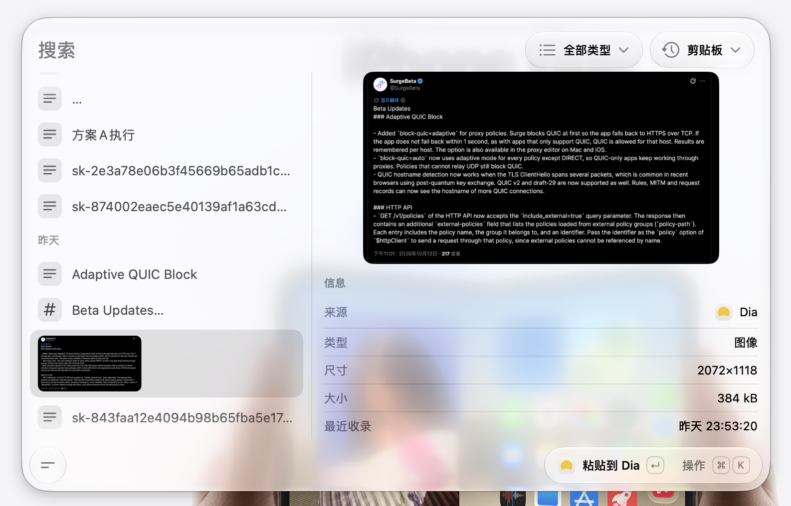

<p align="center">
  
</p>

<h1 align="center">Kit</h1>

<p align="center">
  为键盘工作流设计的原生 macOS 剪贴板历史工具<br>
  捕获文字、代码、链接和图片，快速搜索并粘贴回原应用
</p>

<p align="center">
  <a href="README.md">简体中文</a> ·
  <a href="README.en.md">English</a>
</p>

<p align="center">
  <a href="LICENSE"></a>
  
  
</p>

<p align="center">
  
</p>

## 简介

Kit 将剪贴板历史打造为随叫随到的命令面板，全键盘闭环完成捕获、检索、钉选与粘贴，数据完全保留在本地设备

## 核心功能

- **多类型捕获与智能分类**：自动捕获纯文本、Markdown、代码、链接、文件路径与图片，记录来源应用与时间，使用本地规则分类
- **多维模糊检索与离线 OCR**：基于 SQLite FTS 全文索引秒级响应，支持拼音全拼与首字母检索，内置离线图片文字 OCR 识别，并在图片预览中高亮标注匹配位置
- **全键盘极速流转**：全局快捷键呼出，支持直接粘贴、快速复制与连续粘贴，呼出面板自动切换为英文输入状态，支持误删快捷撤销
- **图片钉选与大图预览**：支持将图片以贴纸形式置顶钉选在屏幕，适配多档尺寸与透明底色棋盘格，列表悬停即时展开无损大图预览
- **Stack 收藏与分类整理**：支持创建自定义 Stack 收藏常用条目，支持快捷键在分组与各数据类型间即时切换
- **隐私保护与自主控制**：数据纯本地存储，支持应用黑名单排除（默认排除钥匙串与系统密码），支持自定义历史保存周期与临时暂停监控
- **原生精致质感**：采用 Swift 原生架构与 Liquid Glass，支持深浅外观，配备按键音效与触控板触感反馈

## 快捷键一览

| 快捷键 | 功能说明 |
| --- | --- |
| `⌥ W` | 呼出或隐藏剪贴板面板（支持自定义） |
| `Return` | 粘贴所选项并关闭面板 |
| `⇧ Return` | 连续粘贴所选项并保持面板打开 |
| `⌘ Return` | 复制所选项至剪贴板 |
| `⌘ K` | 打开条目操作菜单 |
| `⌘ Z` | 撤销上一次删除（文本编辑时优先撤销输入） |
| `⌥ ↓` / `⌥ ↑` | 切换至下一个 / 上一个 Stack 分组 |
| `⌥ ⌘ ↓` / `⌥ ⌘ ↑` | 切换至下一个 / 上一个内容类型筛选 |

## 隐私与权限

剪贴板数据与索引完全保存在本机，不经由任何云端服务，首次粘贴需要按系统提示授予 macOS 辅助功能（Accessibility）权限

## 从源码构建

环境要求：macOS 27+，Xcode 27+，Swift 6.4+

```bash
git clone https://github.com/imeelinew/Kit.git
cd Kit
open Kit.xcodeproj
```

在 Xcode 中选择 **Kit** scheme 并点击 **Product → Run** 即可编译运行

## 许可证

Kit 基于 [GNU Affero General Public License v3.0](LICENSE) 开源
