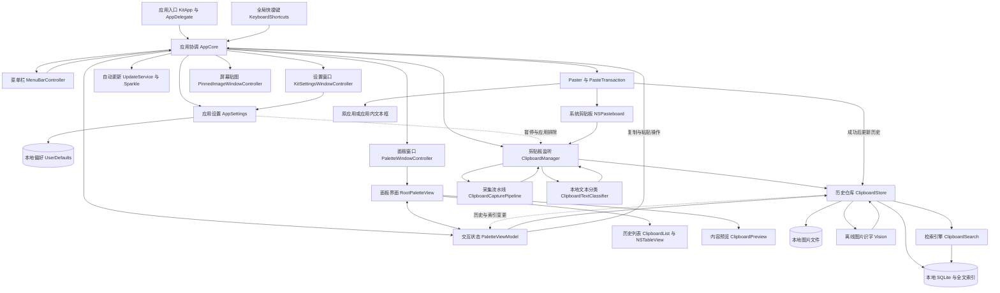
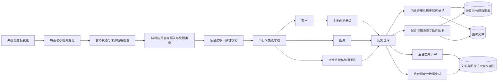
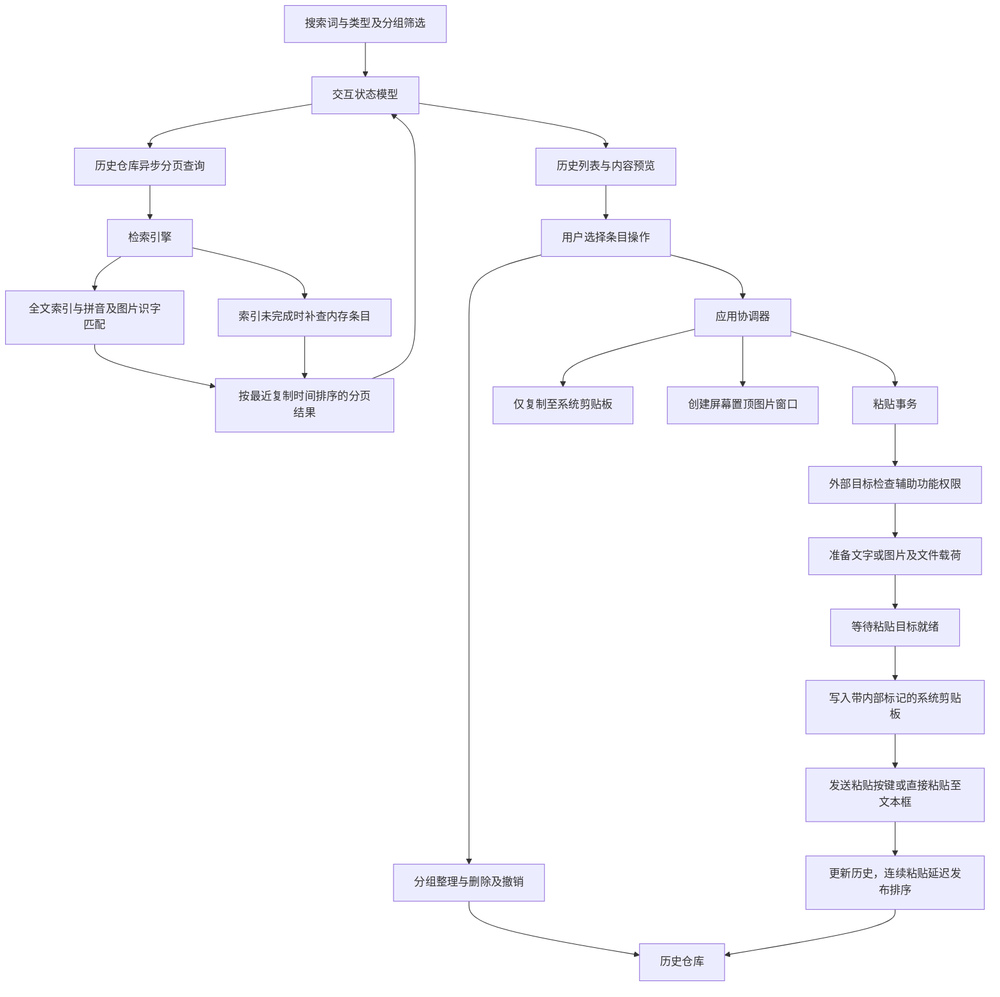

# Kit 应用架构图

## 采集与存储

## 检索与操作

## 源码索引

| 模块 | 源码 |
| --- | --- |
| 启动入口 | [应用入口](../../Kit/App/KitApp.swift) |
| 应用协调 | [核心协调器](../../Kit/Core/AppCore.swift) |
| 窗口与状态 | [面板窗口](../../Kit/Core/PaletteWindowController.swift)、[交互状态](../../Kit/Core/PaletteViewModel.swift) |
| 界面与列表 | [根视图](../../Kit/Features/RootPaletteView.swift)、[历史列表](../../Kit/Features/Clipboard/ClipboardView.swift) |
| 采集与分类 | [剪贴板监听](../../Kit/Core/ClipboardManager.swift)、[采集流水线](../../Kit/Core/ClipboardCapturePipeline.swift)、[规则分类](../../Kit/Core/ClipboardTextClassifier.swift) |
| 历史与存储 | [历史仓库](../../Kit/Core/ClipboardStore.swift)、[数据库结构](../../Kit/Core/ClipboardSQLite.swift) |
| 检索与识字 | [检索引擎](../../Kit/Core/ClipboardSearch.swift)、[拼音元数据](../../Kit/Core/Pinyin.swift)、[图片识字](../../Kit/Core/ClipboardImageOCR.swift) |
| 粘贴与贴图 | [粘贴执行器](../../Kit/Core/Paster.swift)、[粘贴事务](../../Kit/Core/PasteTransaction.swift)、[贴图窗口](../../Kit/Features/Clipboard/PinnedImageWindow.swift) |
| 设置与更新 | [应用设置](../../Kit/Core/AppSettings.swift)、[更新服务](../../Kit/Core/UpdateService.swift) |
